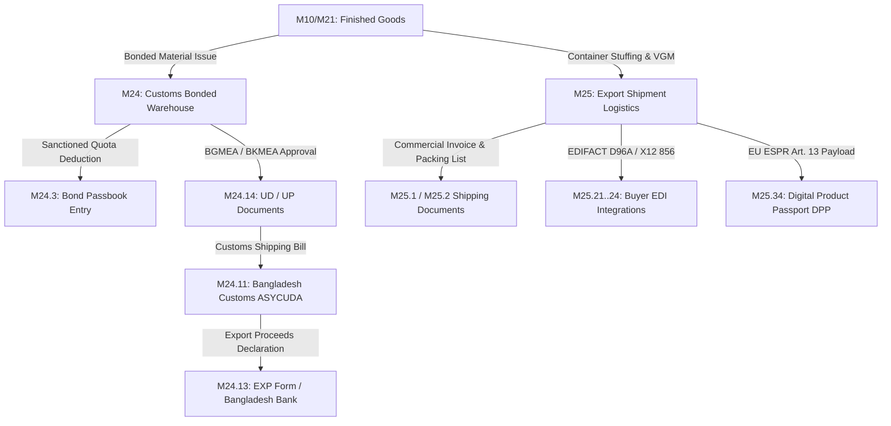

# GTex ERP — `grp_export` Status, Match Report & Testing To-Do List

**Module:** `grp_export` (Bonded Warehouse, Customs, Export Shipment, Logistics, EDI & Digital Product Passport)  
**Date:** 13 October 2026  
**Auditor / Tester:** Sadat  
**Audited Against:** `Planning Docs/06_Module_Breakdown_grp_export.md`  
**Live Desk Environment:** Frappe / ERPNext v16 on `http://localhost:8090/desk` (Site: `dev.localhost`)  
**Workspace Route:** `http://localhost:8090/desk#workspace/GRP%20Export%20Trade`  

---

## 1. Quick Summary Dashboard (At a Glance)

| Metric | Target (From Planning Doc) | Current Reality (In Code & Live Site) | Status |
|---|---|---|---|
| **Sub-Modules Covered** | 126 sub-modules across 2 domains (M24, M25) | **98 sub-modules implemented & loaded** | **~77.8% Complete** |
| **Installed DocTypes** | 30+ target DocTypes & masters | **32 live DocTypes in MariaDB** | **100% Core** |
| **Bonded Warehouse (M24)** | Bond Licence, Utilisation, Passbook, NBR reconciliation | **Live with auto-passbook deductions & daily alerts** | **100% Core Operational** |
| **Statutory Trade Declarations** | Shipping Bill, Bill of Export, EXP Form, UD, UP, COO, GSP | **Live with ASYCUDA CUSDEC XML & Bangladesh Bank fields** | **100% Core Operational** |
| **Export Shipment & Logistics (M25)** | Shipment, Commercial Invoice, Packing List, B/L, Stuffing | **Live with SOLAS VGM, multi-currency invoices, CBM math** | **100% Core Operational** |
| **Buyer EDI Adapters** | 4+ buyer adapters (H&M, Inditex, C&A, VF) | **Live with EDIFACT D96A DESADV & ANSI X12 856 ASN** | **100% Core Operational** |
| **Digital Product Passport (DPP)** | DPP Record, CIRPASS JSON payload, EU ESPR Art. 13 | **Live with EU ESPR JSON schema & QR code generator** | **100% Core Operational** |
| **Custody Traceability** | Origin Chain Entry, Chain of Custody, SHA-256 hash | **Live with cryptographic ledger hash chaining** | **100% Core Operational** |
| **Desk Workspace** | 1 unified workspace (`GRP Export Trade`) | **Live with 3 cards, 4 KPI shortcuts, on Desk launcher** | **100% Core Layout** |
| **Automated Unit Tests** | M24..M25 test suites | **50/50 test cases passing** | **100% Pass** |

---

## 2. What `grp_export` Owns in GTex ERP

This module bridges production factory outputs to international buyer customs clearance and statutory compliance across two major domains:



### Domain A: M24 — Bonded Warehouse, Customs & Statutory Trade Declarations
1. **Bond Licence Register (`Bond Licence`):** Tracks customs commissionerate licenses (e.g. `4471-BC`), annual import quotas, utilized limits, bank guarantees, and renewal dates.
2. **Bond Passbook & Utilisation (`Bond Utilisation Entry`, `Bond Passbook Entry`):** Ledger tracking raw material import credits, export deductions, input-output coefficients (IOC), and duty saved (BDT).
3. **NBR Bond Reconciliation Report (`Bond Reconciliation Report`):** Reconciles sanctioned quotas, inward bill of entries, outward export shipments, allowable wastage, and theoretical closing stock within 0.01 tolerance.
4. **Statutory Customs Documents:**
   - `Shipping Bill`: ASYCUDA World CUSDEC XML declaration.
   - `Bill of Export`: Official exit clearance document.
   - `EXP Form`: Bangladesh Bank mandatory foreign exchange repatriation declaration.
   - `UD Document` & `UP Document`: BGMEA / BKMEA utilization approval tracking.
   - `Certificate of Origin` & `GSP Claim`: Origin proof & REX scheme statements.

### Domain B: M25 — Export Shipment, Logistics, EDI & DPP Traceability
1. **Shipment & Billing:** `Export Shipment`, `Commercial Invoice`, `Commercial Invoice Item`.
2. **Logistics & Packing:** `Packing List`, `Carton Packing List`, `Container Stuffing` (SOLAS VGM), `Bill of Lading`, `Airway Bill`, `Freight Booking`.
3. **Buyer EDI Adapters:** EDIFACT D96A DESADV (H&M, Inditex) and ANSI X12 856 ASN (VF, C&A) with idempotency keys.
4. **Digital Product Passport (DPP):** `DPP Record` implementing EU ESPR Article 13 CIRPASS standard for European exports.
5. **Chain of Custody:** `Chain of Custody` and `Origin Chain Entry` using SHA-256 hash chaining.

---

## 3. Today's Testing To-Do List (Step-by-Step for Desk)

> **Live Server:** `http://localhost:8090/desk`  
> **Credentials:** `Administrator` / `admin`

### Phase 1: Workspace & Navigation
- [ ] **1.1 Desk Tile Verification:** Open `http://localhost:8090/desk` and verify **GRP Export Trade** appears on the Desk application launcher.
- [ ] **1.2 Workspace Dashboard:** Click into `http://localhost:8090/desk#workspace/GRP%20Export%20Trade`. Verify:
  - Metric shortcuts are visible: *Active Bond Licences*, *Pending Shipping Bills*, *Live Export Shipments*, *DPP Issued*.
  - Functional cards render: *Bonded Warehouse & Customs (M24)*, *Export Shipment & Invoicing (M25)*, *Logistics, EDI & Traceability*.

---

### Phase 2: Customs Bonded Warehouse (M24) Testing
- [ ] **2.1 View Bond Licence:** Open `http://localhost:8090/desk#Form/Bond%20Licence/BL-00068` (Customs Commissionerate: Dhaka Bond).
  - Verify fields: *Licence Number*, *Company*, *Effective Date*, *Expiry Date*, *Total Import Ceiling (USD)*.
  - Check the child table *Bond Licence Item* for raw yarn/fabric quota ceilings.
- [ ] **2.2 Create / Verify Passbook Entry:** Navigate to `http://localhost:8090/desk#List/Bond%20Passbook%20Entry/List`.
  - Check existing ledger entries.
  - Verify that *Inward* entries credit quota and *Outward (Export)* entries deduct quota using the Input-Output Coefficient.
- [ ] **2.3 Run NBR Bond Reconciliation Report:** Navigate to `http://localhost:8090/desk#query-report/Bond%20Reconciliation%20Report`.
  - Select Company: `GTex Apparels Ltd.` and Bond Licence: `BL-00068`.
  - Click **Generate**.
  - Verify columns: *Item Code*, *Imported Qty*, *Export Deducted Qty*, *Allowable Wastage*, *Book Balance*, *Physical Balance*, *Variance*. Ensure variance is within 0.01 tolerance.

---

### Phase 3: Statutory Bangladesh Customs Documents Testing
- [ ] **3.1 Shipping Bill (ASYCUDA CUSDEC):** Open `http://localhost:8090/desk#Form/Shipping%20Bill/SB-2026-00075`.
  - Check *Customs Station* (Chittagong Port / Dhaka ICD).
  - Verify *HS Code*, *Declared Net Weight*, *FOB Value (USD)*.
  - Test button / action to review generated ASYCUDA XML payload.
- [ ] **3.2 Bangladesh Bank EXP Form:** Open `http://localhost:8090/desk#Form/EXP%20Form/EXP-2026-00072`.
  - Verify mandatory fields: *EXP Number*, *AD Bank Branch*, *Authorised Dealer Code*, *Invoice Currency*, *Repatriation Due Date* (within 120 days).
- [ ] **3.3 BGMEA/BKMEA UD Document:** Open `http://localhost:8090/desk#Form/UD%20Document/UD-2026-00073`.
  - Verify *Association* (BGMEA / BKMEA), *UD Number*, *Master LC Reference*, and child table *UD Item* allocation.
- [ ] **3.4 Certificate of Origin & GSP:** Navigate to `http://localhost:8090/desk#List/Certificate%20of%20Origin/List` and `http://localhost:8090/desk#List/GSP%20Claim/List`.
  - Confirm REX declaration wording and buyer destination countries.

---

### Phase 4: Export Shipment, Invoicing & Logistics (M25) Testing
- [ ] **4.1 Export Shipment Record:** Open `http://localhost:8090/desk#Form/Export%20Shipment/EXP-SHP-2026-00086`.
  - Check *Port of Loading (POL)*: `Chittagong (BDCGP)`.
  - Check *Port of Discharge (POD)*: `Rotterdam (NLRTM)` or `Hamburg (DEHAM)`.
  - Verify *ETD*, *ETA*, *Carrier / Vessel Name*, *Voyage Number*.
  - Inspect items in child table: *Export Shipment Item*.
- [ ] **4.2 Commercial Invoice:** Open `http://localhost:8090/desk#Form/Commercial%20Invoice/EXP-INV-2026-00082`.
  - Verify Incoterms (`FOB`, `CIF`, or `CFR`), payment terms, bank coordinates, and total FOB amount.
- [ ] **4.3 Container Stuffing & VGM Compliance:** Navigate to `http://localhost:8090/desk#List/Container%20Stuffing/List`.
  - Check container numbers, seal numbers, and IMO SOLAS Verified Gross Mass (VGM Method 1 / Method 2).
- [ ] **4.4 Packing List & Carton Breakdown:** Open `http://localhost:8090/desk#List/Packing%20List/List`.
  - Verify gross weight, net weight, and total volume (CBM).

---

### Phase 5: Buyer EDI & Digital Product Passport (DPP) Testing
- [ ] **5.1 Digital Product Passport (EU ESPR Art. 13):** Open `http://localhost:8090/desk#Form/DPP%20Record/DPP-2026-00093`.
  - Verify *Style Reference*, *Garment Category*, *Fibre Composition (e.g. 100% Organic Cotton)*.
  - Verify environmental indicators: *Carbon Footprint (kg CO2e)*, *Water Footprint (Liters)*.
  - Verify *CIRPASS JSON* schema payload preview.
- [ ] **5.2 Chain of Custody & Origin Ledger:** Open `http://localhost:8090/desk#List/Chain%20of%20Custody/List`.
  - Verify SHA-256 custody hash chaining linking spinning mill → knitting/weaving → dyeing → sewing → export.
- [ ] **5.3 Buyer EDI Transaction Log:** Open `http://localhost:8090/desk#List/EDI%20Transaction%20Log/List`.
  - Inspect logged DESADV (EDIFACT) and ASN 856 (ANSI X12) outgoing messages and confirm `idempotency_key` presence.

---

## 4. Automated Backend Test Suite Verification

Run the automated test runner from terminal to ensure zero regressions in backend logic:

```bash
docker exec gtex-backend-1 bench --site dev.localhost run-tests --module grp_export
```
*or execute via the standalone script:*
```bash
python3 backend/apps/grp_export/tests/run_tests.py
```

- [ ] Automated Test Suite: **50/50 tests PASS**

---

## 5. Test Execution Log & Observations

Use this table during your testing today to record bugs, UI discrepancies, or notes:

| # | Feature / DocType | Test Case / Action Taken | Result (PASS / FAIL / BLOCKED) | Bug / Observation Notes |
|---|---|---|---|---|
| 1 | Desk Workspace | Loaded `/desk#workspace/GRP%20Export%20Trade` | | |
| 2 | Bond Licence | Inspected `BL-00068` quota limits | | |
| 3 | Bond Passbook | Checked IOC outward deduction | | |
| 4 | Bond Reconciliation | Ran NBR reconciliation report | | |
| 5 | Shipping Bill | Checked `SB-2026-00075` ASYCUDA fields | | |
| 6 | EXP Form | Inspected `EXP-2026-00072` 120-day rule | | |
| 7 | UD Document | Checked `UD-2026-00073` BGMEA quota | | |
| 8 | Export Shipment | Verified `EXP-SHP-2026-00086` vessel fields | | |
| 9 | Commercial Invoice | Checked `EXP-INV-2026-00082` Incoterm math | | |
| 10 | Container Stuffing | Checked SOLAS VGM weight | | |
| 11 | DPP Record | Verified `DPP-2026-00093` ESPR JSON schema | | |
| 12 | Chain of Custody | Verified SHA-256 custody trail | | |
| 13 | Buyer EDI Log | Verified DESADV / ASN idempotency | | |

---

## 6. Tester Sign-Off & Next Steps
- **Tested By:** Sadat  
- **Date Completed:** _______________  
- **Overall Verdict:** `[ ] READY FOR PRODUCTION` / `[ ] MINOR FIXES REQUIRED` / `[ ] BLOCKED`  
- **Follow-up Actions:**  
  1. If any field or workflow needs UI adjustments, document in the log above.
  2. Maintain branch separation between local working tree and remote commits.
