# GTex ERP — End-to-End Enterprise Flow & Operational Architecture Report
## Complete Factory Lifecycle: From Foreign Buyer Enquiry to Dollar Realization & Worker Payroll

**Project:** Garments & Textile Industry ERP (GTex ERP)  
**Date:** 17 October 2026  
**Author / Analyst:** Sadat (Tahmid Sadat)  
**File:** `todos and reports/sadat_report_17oct26.md`  
**Target Folder:** `/Users/laptopparadise/Documents/Textile/todos and reports/`  
**Primary Source References:**  
- `full_project_flow.md` (Complete Architecture, User Manuals & System Guide)  
- `simple_project_story.md` (The 8-Stage Story & Character Role Walkthrough)  
- `kahini.md` (The Real-World Narrative: Order to Cash & Digital Shopfloor Journey)  
- `sub_module_project_flow.md` (Submodule 1.1 to 17.5 Operational Map)  
- `ALL_MODULES_FUNCTIONAL_GUIDE_BN_EN.md` (Comprehensive English & Bengali Functional Guide)  

**Live System Environments:**  
- **Desktop Frontend Shell:** [`http://localhost:3000`](http://localhost:3000) (Next.js 15 Fluent-2 Enterprise Cockpit)  
- **Backend Admin Console:** [`http://localhost:8090/desk`](http://localhost:8090/desk) & [`http://localhost:8081/app`](http://localhost:8081/app) (Frappe v16 + MariaDB 10.11, Site: `dev.localhost`)  
- **Specialized PWAs:** Buyer Portal (`/buyer`), Worker Self-Service ESS (`/worker`), Shopfloor MES Tablet (`/garment`)  

---

## 1. Executive Summary & The Core Narrative

### 1.1 The Whole Project in One Sentence
> **"Foreign Buyer Arman orders polo shirts ➔ Senior Merchandiser Nusrat plans the BOM recipe and locks the TNA calendar ➔ Central Planner Farhan schedules factory sewing lines ➔ Sourcing and Textile Mills spin, knit, and dye the fabric ➔ The Warehouse inspects rolls on a 4-point scale, and the Cutting Room slices bundles with QR barcode tickets ➔ Sewing operators stitch with real-time tablet tracking ➔ Quality and Finishing pass needle-detection safety tests and AQL audits ➔ Customs bond clears the shipping containers ➔ Arman’s bank wires the dollars, NBR VAT is filed, and workers receive their salaries and overtime directly on their mobile phones."**

### 1.2 Purpose of this Report
Today (17 October 2026), a complete architectural and operational synthesis of the entire **GTex ERP** ecosystem was achieved. This report documents the end-to-end business flow, the 17 organizational user personas, the 10 modular applications (`grp_*`), the 43 core business submodules (M01–M43), and the seamless synchronization between the Next.js Fluent-2 frontend and the Frappe Desk MariaDB backend.

---

## 2. The 17 Personas: Who Does What Across the Enterprise?

A tier-1 vertically integrated garments and textile manufacturing conglomerate operates across 17 distinct user personas, each interacting with specialized ERP surfaces:

| # | Persona / Character | Department / Scope | Core Operational Responsibilities | Primary Interface |
|---|---|---|---|---|
| **1** | **Arman** | Foreign Buyer (Global Brand) | Submits style enquiries, approves tech packs and lab dips, tracks live TNA, inspects AQL certificates. | Buyer Portal (`/buyer`) |
| **2** | **Nusrat Jahan** | Senior Merchandiser | Manages buyer profiles, handles RFQs, negotiates FOB costing, books Sales Orders, tracks critical-path TNA. | Desktop Web (`/commercial`) |
| **3** | **Tanvir** | Product Dev & CAD Specialist | Prepares digital Tech Packs, computes Bill of Materials (BOM), designs CAD markers, oversees sample rooms. | Desktop Web (`/product`) |
| **4** | **Farhan** | Central Production Planner (PPIC) | Executes factory capacity modeling, runs multi-line Gantt boards, manages MPS rolling fences and S&OP cycles. | Desktop Web (`/planning`) |
| **5** | **IE Lead** | Industrial Engineering | Performs SMV time studies, builds operation bulletins, suggests real-time line rebalancing and pitch swaps. | Desktop Web (`/garment`, `/planning`) |
| **6** | **Alam** | Cutting Room Master | Manages Cut Order Planning (COP), lays fabric plies, cuts parts, prints QR barcode bundle tickets. | Floor App / Desktop (`/garment`) |
| **7** | **Salma** | Sewing Floor Operator | Stitches garment operations, scans bundle QR tickets via workstation tablets, reports machine downtime. | Floor MES Tablet (`/garment`) |
| **8** | **Floor Supervisor / Line Chief** | Sewing MES | Monitors hourly production line wall tiles, tracks target vs output curves, reallocates floating helpers. | Floor MES Tablet (`/garment`) |
| **9** | **Nasir** | QC Inspector & Lab Analyst | Logs inline/endline defects, runs ASTM D5430 4-point fabric tests, conducts ANSI/ASQ Z1.4 AQL audits, checks LIMS. | Mobile Tablet / Web (`/quality`) |
| **10**| **Bari** | Finishing & Packing Lead | Directs ironing, enforces 100% metal/needle detection, manages cartonization, generates packing lists. | Floor App / Desktop (`/garment`) |
| **11**| **Kabir** | Textile Mill & Dyeing Master | Oversees ringframe spinning (RF-01..08), circular knitting (KM-01..08), HT dyeing vessels, and colour lab recipes. | Desktop Web (`/textile`) |
| **12**| **Sumon / Rafiq** | Sourcing & Fabric Store Officer | Issues purchase orders, opens Back-to-Back LCs, conducts 4-point raw fabric inspection, issues rolls to cutting. | Desktop Web (`/supply`) |
| **13**| **Tareq** | Commercial & Customs Officer | Manages NBR bonded warehouse passbooks, ASYCUDA Shipping Bills, Bangladesh Bank EXP forms, and container stuffing. | Desktop Web (`/trade`) |
| **14**| **Zubair** | Finance & Accounts Manager | Manages general ledger, settles B2B supplier bills, tracks export proceeds realization, executes payroll. | Desktop Web (`/finance`) |
| **15**| **HR & Compliance Officer** | Human Resources | Audits biometric attendance, approves leave, manages BLA compliance, handles worker grievances. | Desktop Web (`/people`, `/governance`) |
| **16**| **EHS & Maintenance Engineer** | Plant Engineering | Monitors boiler steam, ETP wastewater parameters, generator fuel, logs sewing machine PM/repair tickets. | Desktop Web (`/plants`, `/governance`) |
| **17**| **Managing Director / COO** | Executive Suite | Monitors consolidated executive dashboards, on-time in-full (OTIF) shipping, factory gross margin, and net cash flow. | Executive Cockpit (`/dashboard`) |

---

## 3. High-Level Enterprise Architecture Blueprint

The entire system links 10 modular applications (`grp_*`) across 3 unified presentation surfaces:

```mermaid
flowchart TD
    subgraph Presentation_Layer ["Presentation Surfaces"]
        P1["Next.js D365 Fluent-2 Web Cockpit (:3000)"]
        P2["Frappe Desk Backend Console (:8090 / :8081)"]
        P3["Floor MES Tablet / Worker PWA / Buyer Portal"]
    end

    subgraph Core_Platform ["Core Platform & Governance"]
        C1["grp_core (M40–M43): Authentication, RBAC, Multi-Tenant Security, Audit Trail"]
        C2["grp_mis (M38–M39): Executive KPI Dashboard & Predictive Analytics"]
    end

    subgraph Commercial_Supply_Stream ["Commercial & Supply Chain Stream"]
        D1["grp_commercial (M01-M03, M08-M09)\nBuyer Enquiries · Costing · Order Book · TNA · Central Planning"]
        D2["grp_supplychain (M10-M13)\nSourcing · Purchase Orders · Central Stores · Fabric 4-Point Roll Inventory"]
    end

    subgraph Manufacturing_Stream ["Manufacturing & Quality Stream"]
        M1["grp_textile (M14-M17)\nCotton Spinning · Circular Knitting · HT Jet Dyeing · Colour Lab Spectro"]
        M2["grp_garment (M04-M07, M18-M21)\nTech Pack CAD · Cut Order Plan · Bundle QR Tickets · Sewing MES · Finishing"]
        M3["grp_compliance (M22-M23, M34-M37)\nInline QC · ANSI AQL Audits · LIMS Chemical/Physical Lab · EHS & Anti-Gaming"]
    end

    subgraph Trade_Finance_Stream ["Statutory Trade, Finance & Local Operations"]
        F1["grp_export (M24-M25)\nCustoms Bonded Warehouse · ASYCUDA Shipping Bills · EXP Forms · DPP Traceability"]
        F2["grp_finance (M26-M28)\nChart of Accounts · Supplier Payables · Export FX Proceeds Realization · B2B LC"]
        F3["grp_bdlocal (M29A-F, M30-M33)\nNBR VAT Mushak 4.3/6.3 · Biometric Attendance · Bangladesh Labour Act Payroll"]
    end

    Presentation_Layer <--> Core_Platform
    Core_Platform <--> Commercial_Supply_Stream
    Commercial_Supply_Stream <--> Manufacturing_Stream
    Manufacturing_Stream <--> Trade_Finance_Stream
```



---

## 4. The 8-Stage End-to-End Order Lifecycle (The Life of an Order)

```
[1. Enquiry & Profile] ──► [2. BOM & Costing] ──► [3. Order & TNA] ──► [4. Capacity & Scheduling]
      (M01/M04)                 (M05/M06)             (M02/M03)                 (M08/M09)
          │
          ▼
[5. Sourcing & Textile] ─► [6. Store & Cutting] ─► [7. Sewing & QC] ─► [8. Export, FX & Payroll]
      (M10/M14-M17)             (M11/M12/M19)       (M13/M20-M22)            (M24-M29)
```

### Stage 1: Buyer Profile, Enquiry & Requirements (M01, M04)
* **What Happens:** Foreign buyer **Arman** (Global Apparel Brand) reaches out with an enquiry for **50,000 polo shirts**.
* **System Action:** Senior Merchandiser **Nusrat** creates Arman’s profile in `Buyer Master` (`tabBuyer Profile`), sets up buyer-specific quality tolerances (AQL 1.5, strict metal detection), registers the liaison agent, and logs `Buyer Enquiry` (`tabBuyer Enquiry`).
* **Technical Output:** Generates unique buyer ID `BUY-00090` and style placeholder `MN-PL412`.

### Stage 2: Tech Pack, Recipe (BOM) & Pre-Costing (M05, M06, M07)
* **What Happens:** CAD Designer **Tanvir** creates the digital measurement spec and Bill of Materials (BOM).
* **System Action:**
  - `Tech Pack & BOM Engine`: Defines consumption—1.35 yards single jersey 160 GSM fabric, 3 mother-of-pearl buttons, 1 woven main label, 1 care label, 120m sewing thread.
  - `SMV Study (IE)`: Industrial Engineer sets the Standard Minute Value at **16.8 minutes**.
  - `Pre-Costing Sheet`: Nusrat aggregates raw fabric cost ($2.20), trims/accessories ($0.50), cut-make-trim CM ($0.95), wash/print ($0.15), and commercial profit margin ($0.40) $\rightarrow$ **FOB Price: $4.20 / piece**.
* **Technical Output:** Approved costing quote `COST-2026-00441` sent to buyer.

### Stage 3: Order Booking, Size-Colour Matrix & Automated TNA (M02, M03)
* **What Happens:** Arman signs the proforma invoice and opens Master Export LC `LC-2026-9810`.
* **System Action:**
  - Nusrat confirms `Sales Order` `PO-77190` in the `Order Book`, specifying size breakdown (XS: 5k, S: 15k, M: 20k, L: 8k, XL: 2k) across Navy Blue and White.
  - **Automated TNA Generation:** The system performs **backward scheduling** from the Ex-Factory date (60 days out), calculating firm deadlines for Yarn In-House (Day 15), Lab Dip Approval (Day 18), Fabric In-House (Day 28), PP Sample Sign-off (Day 32), Cutting Start (Day 35), Sewing Start (Day 38), and Final Packing (Day 54).
* **Technical Output:** `tabTime and Action Calendar` locks critical-path milestones with red-flag milestone alerts.

### Stage 4: Central Planning, Capacity Modeling & Line Loading Gantt (M08, M09)
* **What Happens:** Central Planner **Farhan** determines where and when to manufacture the order.
* **System Action:**
  - In `http://localhost:3000/planning`, Farhan evaluates the `Factory Capacity Model` for Ashulia Knitwear Campus (`PAL-ASH`).
  - He loads the multi-line visual Gantt scheduler (`?view=board`) and books **Sewing Lines 3 and 4** for 12 days.
  - Runs IE Auto-Balance (`🪄 Auto-balance`): reallocates floating helpers to operation 14 (placket stitch) to boost target line efficiency from 58% to 74%.
* **Technical Output:** Submits `tabLine Loading Plan` and updates 8-week `Master Production Schedule` (MPS).

### Stage 5: Sourcing, Procurement & Textile Mill Production (M10, M14–M17)
* **What Happens:** Raw cotton is spun, knitted, and dyed; buttons and accessories are purchased.
* **System Action:**
  - Sourcing Officer **Sumon** opens Back-to-Back (BTB) import LCs for buttons and thread.
  - In our textile mill (`PTL-GAZ`), Textile Master **Kabir** enters:
    - `Spinning Log`: Ringframes `RF-01..08` spin 100% combed cotton yarn (30/1 Ne).
    - `Knitting Log`: Circular knitting machines `KM-01..08` knit greige single jersey rolls.
    - `HT Dyeing Console` (`?view=dyeing`): 14 HT jet vessels dye fabric to Navy Blue (`REC-NAVY-01`); Spectrophotometer verifies $\Delta E \le 0.7$ CMC pass; batch `DY-4471` is released.
    - `Stenter Log`: Fabric is heat-set and compacted to 160 GSM, 64" width with $<3\%$ shrinkage.
* **Technical Output:** Finished fabric rolls (`tabFabric Roll`) dispatched with barcodes to central stores.

### Stage 6: Fabric Store 4-Point Inspection, Cutting Room & QR Bundle Tickets (M11, M12, M19)
* **What Happens:** Fabric arrives at the central warehouse and is cut into garment components.
* **System Action:**
  - Store Officer **Rafiq** mounts rolls on a backlit inspection frame and executes the **ASTM D5430 Fabric 4-Point Inspection**: penalizing defects ($<3'' = 1\text{ pt}, 3-6'' = 2\text{ pts}, 6-9'' = 3\text{ pts}, >9'' = 4\text{ pts}$). Only rolls scoring $<28$ pts/100 sq. yd (Grade A) pass into stock.
  - Cutting Master **Alam** runs `Cut Order Planning (COP)`, spreads fabric plies, and cuts parts using CAD markers.
  - **QR Barcode Bundling:** The system prints a tamper-proof QR barcode ticket for every bundle of 60 plies (collars, sleeves, front bodies, back bodies).
* **Technical Output:** Pre-numbered, barcoded bundles staged for sewing lines.

### Stage 7: Sewing Floor MES Live Tracking, Quality Audits & Finishing (M13, M15, M20–M22)
* **What Happens:** Operators stitch garments, QC tracks defects, and shirts are finished and packed.
* **System Action:**
  - Operator **Salma** and her line-mates scan bundle QR codes using shopfloor workstation tablets. Live wall tiles update hourly output.
  - In `http://localhost:3000/quality`, QC Inspector **Nasir** logs defects via closed-vocabulary codes (`ST-01` Broken Stitch, `WA-02` Oil Spot).
  - **PRD-F156 Anti-Gaming Engine:** Constantly compares inline DHU against end-of-line audits; flags red alert if divergence exceeds 5%.
  - Finishing Lead **Bari** oversees steam pressing and passes **100% of finished garments through a 9-point Conveyor Metal Detector** (ensuring zero broken needle tips).
  - Garments are folded, poly-bagged, cartonized, and labeled.
  - Arman's third-party auditor inspects random cartons under **ANSI/ASQ Z1.4 Normal Level II (AQL 1.5)** and signs the digital Pass Certificate.
* **Technical Output:** Finished goods (`tabFinished Goods Entry`) moved to export holding bay.

### Stage 8: Bonded Warehouse Customs Clearance, Export Logistics, Banking FX Realization & Payroll (M16, M17, M24–M29)
* **What Happens:** Goods are cleared through customs, loaded onto cargo ships, dollars arrive in the bank, and workers get paid.
* **System Action:**
  - Commercial Officer **Tareq** balances the NBR Bond Register (`tabBond Passbook Entry`), deducting raw fabric import quotas using statutory Input-Output Coefficients (IOC).
  - Generates ASYCUDA World CUSDEC `Shipping Bill`, Bangladesh Bank `EXP Form`, BGMEA `Utilization Declaration (UD)`, and EU ESPR `Digital Product Passport (DPP)` QR code.
  - Containers are stuffed under SOLAS VGM certification and loaded at Chittagong Port onto a container vessel bound for Europe.
  - Buyer Arman receives shipping docs; his bank releases export proceeds via SWIFT.
  - Finance Manager **Zubair** settles the export proceeds realization, records currency exchange gains, and auto-generates NBR VAT Mushak 4.3 (input-output coefficient) and Mushak 6.3 tax invoices.
  - HR & Accounts run monthly payroll: computing biometric attendance, overtime (BLA 2-hour daily rule), and disbursing net salaries directly to workers' bKash/Nagad accounts.
  - Managing Director opens the Executive Dashboard: **Order PO-77190 shipped 100% OTIF, zero critical defects, 14.2% net profit margin achieved!**
* **Technical Output:** Fully reconciled, audit-cleared, closed export transaction.

---

## 5. Quick Navigation Directory: "Where to Click for Which Task?"

| Business Activity / Real-World Need | Next.js Frontend URL | Frappe Desk DocType / Shortcut | Underlying MariaDB Table |
|---|---|---|---|
| **Registering a New Buyer Profile** | `/commercial` | `Buyer Profile List` | `tabBuyer Profile` |
| **Booking a Sales Order / PO** | `/commercial/orders` | `Sales Order List` | `tabSales Order` |
| **Tracking TNA Milestones & Deadlines** | `/commercial/tna` | `TNA Calendar List` | `tabTime and Action Calendar` |
| **Pre-Costing & Price Negotiation** | `/product/costing` | `Garment Costing List` | `tabGarment Costing` |
| **Line Loading Board & Gantt Scheduling**| `/planning?view=board` | `Line Loading Plan List` | `tabLine Loading Plan` |
| **Buyer Demand Forecasting Ledger** | `/planning?view=demand`| `Demand Forecast List` | `tabDemand Forecast` |
| **Factory Capacity & Machine Inventory**| `/planning?view=capacity`| `Production Line List` | `tabProduction Line` |
| **Purchasing Yarn, Buttons & Accessories**| `/supply/purchase` | `Purchase Order List` | `tabPurchase Order` |
| **Fabric 4-Point Roll Inspection** | `/supply/rolls` | `Mill Inspection List` | `tabMill Inspection` |
| **Spinning Mill Spindle Monitoring** | `/textile?view=spinning` | `Spinning Log List` | `tabSpinning Log` |
| **Circular Knitting Floor Telemetry** | `/textile?view=knitting` | `Knitting Log List` | `tabKnitting Log` |
| **HT Jet Dyeing Batch Releases** | `/textile?view=dyeing` | `Dye Lot List` | `tabDye Lot` |
| **Colour Lab Recipes & Liquor Multiplier**| `/textile?view=recipe` | `Dye Recipe List` | `tabDye Recipe` |
| **Cut Order Planning & Bundle Tickets** | `/garment/cutting` | `Cut Order Plan List` | `tabCut Order Plan` |
| **Sewing Floor Live MES & Hourly Output** | `/garment?view=sewing` | `Hourly Production Board`| `tabHourly Production Board` |
| **Quality Console & AQL Sampling** | `/quality` | `Final Inspection List` | `tabFinal Inspection` |
| **PRD-F156 Anti-Gaming DHU Audit** | `/quality?view=analytics`| `QMS Audit List` | `tabQMS Audit` |
| **LIMS Physical & Chemical Lab Testing** | `/quality?view=testing` | `Physical Test List` | `tabPhysical Test` |
| **Instrument Metrology Calibration** | `/quality?view=instruments`| `Calibration Record List`| `tabCalibration Record` |
| **Finishing & Needle Detection Logs** | `/garment/finishing` | `Finishing Log List` | `tabFinishing Log` |
| **Cartonization & Packing List** | `/trade/packing` | `Packing List List` | `tabPacking List` |
| **Customs Bond Licence & Passbook** | `/trade/bond` | `Bond Licence List` | `tabBond Licence` |
| **ASYCUDA Shipping Bill & EXP Form** | `/trade/customs` | `Shipping Bill List` | `tabShipping Bill` |
| **Digital Product Passport (EU ESPR)** | `/trade/dpp` | `DPP Record List` | `tabDPP Record` |
| **NBR VAT Mushak 4.3 & 6.3 Filing** | `/finance/vat` | `VAT Mushak Entry List` | `tabVAT Mushak Entry` |
| **Worker Attendance, Payroll & Pay-slips**| `/people/payroll` | `Salary Slip List` | `tabSalary Slip` |
| **Executive C-Suite KPI Cockpit** | `/dashboard` | `Executive KPI Dashboard`| `tabExecutive Metric Log` |

---

## 6. Key Strategic Insights Gained Today (17 Oct 2026)

1. **Why Backward Scheduling in TNA is Paramount:**  
   In garments export, the delivery date in the Master LC is legally immutable. Missing it results in air-freight penalties (costing $3.50/kg) or order cancellation. The GTex ERP TNA engine anchors to the Ex-Factory date and calculates backward constraints, ensuring fabric and trims arrive *before* the cutting date.
2. **The Power of QR Bundle Tickets:**  
   Garments are cut in stacks of 60–100 plies. Without bundle tickets, shade variations and mixed sizes cause massive rejection rates. The GTex system serializes every bundle ticket with a QR code, ensuring every sleeve and collar belongs to the exact same dye roll.
3. **Automated Line Balancing Mitigates Hidden Bottlenecks:**  
   A line produces at the speed of its slowest operator. Today's deep dive showed how the IE module dynamically suggests operator swaps at operation 14, transforming a 58% bottleneck into a 74% high-efficiency line.
4. **Statutory Anti-Gaming & Customs Protection:**  
   Factory floor supervisors often under-report defects to maintain bonus incentives. PRD-F156 mathematically catches discrepancies $>5\%$ between inline and packing stations. Similarly, customs bond reconciliation prevents unauthorized domestic fabric leakage, protecting the factory from NBR audits and severe financial penalties.

---

## 7. Conclusion & Next Operational Steps

With the entire enterprise lifecycle thoroughly mapped and understood:
- **Phase 1 Complete:** Theoretical and architectural comprehension of the 10 apps, 15 domains, and 43 submodules.
- **Phase 2 In Progress:** Field-by-field verification across Next.js interactive controls, Frappe Desk forms, and MariaDB persistence.
- **Phase 3 Ready:** Live test execution on active shopfloor screens, automated regression testing, and pushing synchronized daily reports to GitHub repository `TahmidSadat02/DailyWork.git`.
